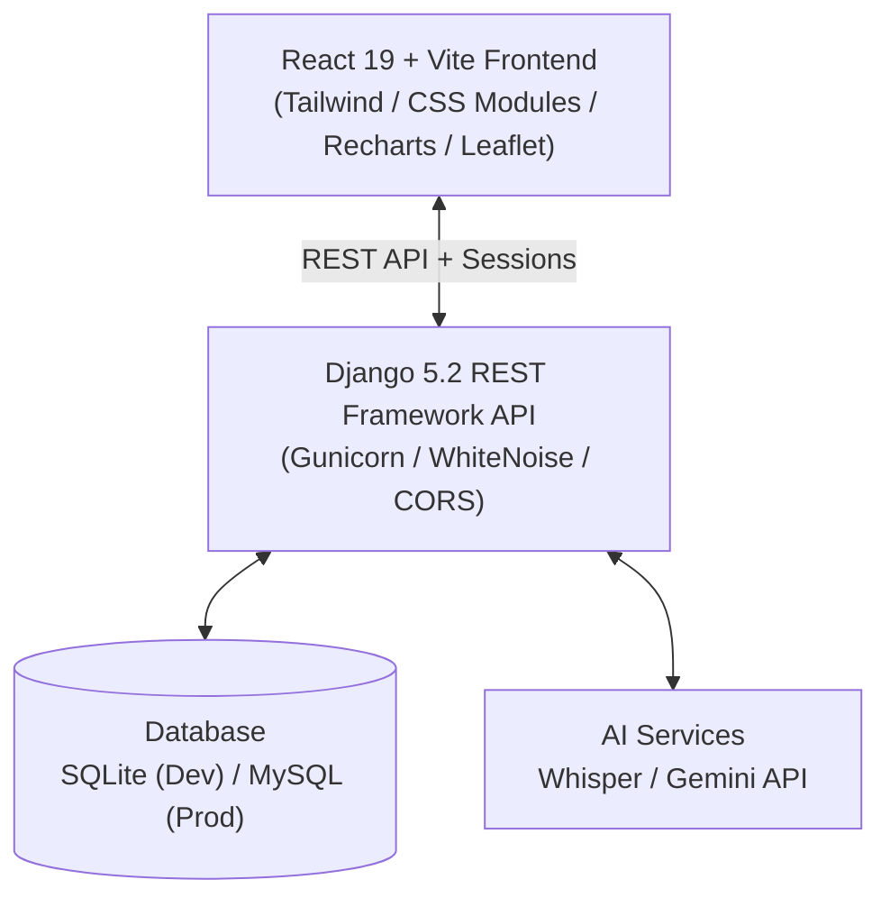

# Fix My Village – Smart Village Management System 🌾

An intelligent, production-ready digital governance platform connecting villagers, Panchayat administrators, and field workers into a single transparent ecosystem.

---

## 🌟 Key Features

1. **Bilingual Experience (Telugu & English)**: Complete local language support for villagers and administrators, including voice guidance and audio read-outs.
2. **Interactive GPS Location Picker**: Live geolocation with OpenStreetMap and Esri satellite hybrid layers, featuring dual markers (blue GPS dot + draggable red pin).
3. **Voice Complaint Registration**: Bilingual voice-based issue filing with real-time waveform recording and auto-fill transcription.
4. **Smart Issue Prioritization**: Automated urgency scoring and severity classification powered by AI.
5. **Real-time Status Tracking**: Color-coded lifecycles for issues (`Pending`, `In Progress`, `Resolved`, `Closed`) with live audit logs.
6. **Worker Assignment & Navigation**: Direct task allocation to field workers with one-tap Google Maps turn-by-turn navigation.
7. **Panchayat Announcements**: Instant broadcasts for public health alerts, water supply timings, and governance updates.
8. **Feedback & Citizen Rating**: Citizens can rate work quality and post post-resolution reviews.
9. **Visual Analytics & Heatmaps**: Recharts-based administrative dashboards and interactive geographic distribution maps.
10. **Fully Responsive Mobile Interface**: Optimized from ultra-compact smartphones (320px) to high-resolution desktop displays (1440px+).

---

## 🏗️ Architecture & Tech Stack



- **Frontend**: React 19, Vite 7, React Router, Leaflet, React-Leaflet, Recharts, Lucide Icons.
- **Backend**: Django 5.2, Django REST Framework, WhiteNoise, django-cors-headers, PyMySQL.
- **AI/ML**: Google Gemini API, Local Speech Processing.

---

## 🚀 Getting Started (Development)

### 1. Prerequisites
- Python 3.12+
- Node.js 18+ and npm
- (Optional) MySQL Server for production

### 2. Backend Setup
```bash
cd fixmyvillage/server

# Activate virtual environment
source env/bin/activate

# Install dependencies
pip install -r requirements.txt

# Run migrations
python manage.py migrate

# Start backend server
python manage.py runserver 127.0.0.1:8000
```

### 3. Frontend Setup
```bash
cd fixmyvillage/client

# Install npm dependencies
npm install

# Start Vite development server
npm run dev
```

Visit `http://localhost:5173` in your browser.

---

## ⚙️ Environment Variables

### Backend (`fixmyvillage/server/.env`)
See `fixmyvillage/server/.env.example` for the complete template:
```env
SECRET_KEY=your-production-secret-key
DEBUG=False
ALLOWED_HOSTS=yourdomain.com,127.0.0.1,localhost
CORS_ALLOWED_ORIGINS=https://yourdomain.com,http://localhost:5173
CSRF_TRUSTED_ORIGINS=https://yourdomain.com,http://localhost:5173
DB_NAME=smartvillage
DB_USER=smartvillage_user
DB_PASSWORD=your_password
DB_HOST=localhost
DB_PORT=3306
GEMINI_API_KEY=your-gemini-key
```

### Frontend (`fixmyvillage/client/.env`)
See `fixmyvillage/client/.env.example`:
```env
VITE_APP_TITLE=Smart Village - Fix My Village
```

---

## 🚢 Production Deployment

Detailed Nginx, Gunicorn, Systemd, and SSL configurations are available in:
👉 [`deployment/DEPLOYMENT.md`](file:///home/praveen/Smart_village/fixmyvillage/deployment/DEPLOYMENT.md)
