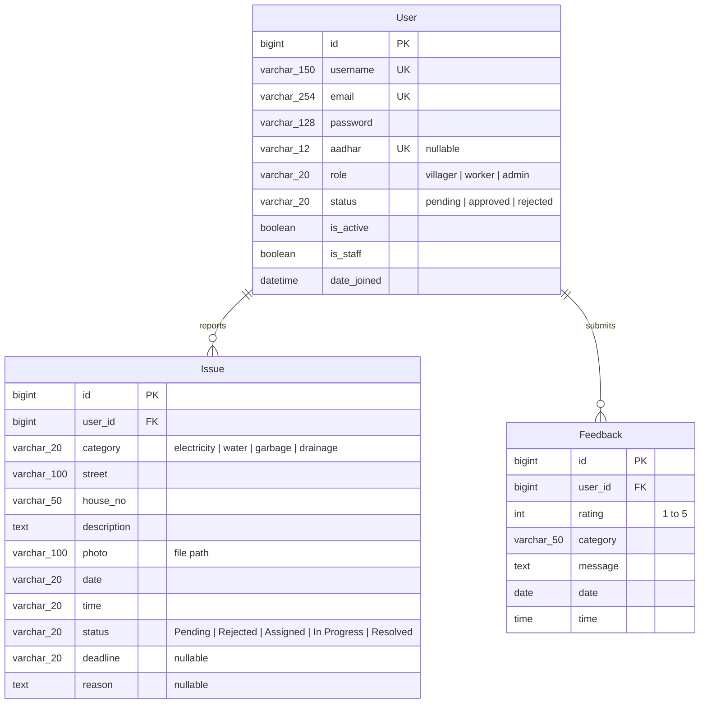

# 🌱 Fix My Village — Community Issue Reporting & Governance Platform

> A full-stack civic engagement and municipal problem resolution platform built with **Django REST Framework (DRF)**, **React 19**, **Vite**, and **MySQL**. It enables villagers to report local infrastructure issues, field workers to manage and resolve assigned tasks, and administrators to govern user registrations and monitor civic feedback.

---

## 1. Project Overview

**Fix My Village** bridges the communication gap between rural citizens, civic maintenance workers, and village administrators. Rural communities frequently face infrastructural challenges involving electricity faults, water supply breakdowns, uncollected garbage, and sewage drainage failures. 

Through this platform:
- **Villagers** register using verified credentials (including Aadhar numbers) and await administrative approval before submitting geo-tagged reports with image proof.
- **Workers** receive categorized issues in real-time, transition issue states from "Assigned" through "In Progress" to "Resolved", and commit completion deadlines.
- **Administrators** control access by vetting citizen signup requests, viewing civic feedback, monitoring issue resolution statuses, and deleting inappropriate feedback.

The system decouples client and server architectures: a high-performance **React 19 Single Page Application (SPA)** powered by **Vite** communicates over REST APIs with a **Django REST Framework (DRF)** backend backed by a **MySQL** database.

---

## 2. Key Features

### 👨‍🌾 Villager Portal
- **Identity Registration**: Citizens register with username, email, password, and a 12-digit unique Aadhar number; accounts start in `pending` status.
- **Issue Submission**: Report issues across 4 core municipal domains (`electricity`, `water`, `garbage`, `drainage`) with street name, house number, textual description, timestamp, and photograph upload (`multipart/form-data`).
- **Live Issue Tracking**: Monitor submission lifecycle through color-coded badges (`Pending`, `Assigned`, `In Progress`, `Resolved`, `Rejected`).
- **Civic Feedback**: Rate community maintenance performance on a 1–5 star scale with detailed comments.

### 👷 Field Worker Dashboard
- **Category Filter Tabs**: View issues categorized by domain (Electricity, Water, Garbage, Drainage).
- **Task Progression Engine**: Transition issue statuses sequentially:
  - `Assigned` $\rightarrow$ `In Progress` $\rightarrow$ `Resolved`
- **Deadline Commitment**: Set expected completion dates during task progression.
- **Rejection with Reason**: Reject unfeasible or duplicate issues with documented justifications.
- **Productivity Metrics**: Real-time counter of total assigned tasks, pending actions, and resolved issues.

### 🛡️ Administrative Governance
- **Citizen Onboarding Vetting**: Review incoming villager registration requests with Aadhar numbers, approving or rejecting applicant profiles.
- **Complete Issue Oversight**: Global inspection of all village issues across all categories.
- **Citizen Feedback Analytics**: Inspect community sentiment, rating distributions, and delete redundant feedback entries.
- **Role-Based Security**: Role-based access control protecting all administrative endpoints.

---

## 3. Technology Stack

### Backend
- **Language**: Python 3.10+
- **Web Framework**: Django 5.2.17
- **API Framework**: Django REST Framework (DRF) 3.18.0
- **Database Connector**: `mysqlclient` 2.2.8
- **Image Processing**: `Pillow` 12.3.0 (handling issue photo uploads)
- **Environment Management**: `python-dotenv` 1.2.3
- **WSGI / ASGI**: `asgiref` 3.12.1

### Database
- **Engine**: MySQL 8.x / MariaDB
- **ORM**: Django ORM (Foreign Keys, relational cascades, status and role enumerations)

### Frontend
- **Library**: React 19.2.0
- **Build Tool / Bundler**: Vite 7.3.1 (with API and media reverse proxying)
- **Routing**: React Router DOM 7.13.0
- **Animations**: Framer Motion 12.34.3
- **Data Visualization**: Recharts 3.8.0
- **Styling**: Modular CSS3 stylesheets with responsive grid and flexbox

---

## 4. System Architecture

```text
┌─────────────────────────────────────────────────────────────┐
│                   React 19 + Vite Frontend                  │
│                     (http://localhost:5173)                 │
│                                                             │
│   Villager Dashboard  │  Worker Dashboard  │  Admin Panel   │
└───────────────┬─────────────────────────────────────────────┘
                │ HTTP REST Calls (Cookies / CSRF Token / JSON)
                │ Vite Reverse Proxy (/api -> :8000, /media -> :8000)
                ▼
┌─────────────────────────────────────────────────────────────┐
│                 Django 5.2 REST Framework Backend           │
│                     (http://127.0.0.1:8000)                 │
│                                                             │
│  ┌───────────────────────────────────────────────────────┐  │
│  │ Middleware: Security, Session, CSRF, Authentication  │  │
│  └───────────────────────────────────────────────────────┘  │
│                                                             │
│    ┌──────────┐    ┌─────────────┐    ┌──────────┐    ┌───┐ │
│    │  users   │    │ admin_panel │    │  issues  │    │fb │ │
│    └────┬─────┘    └──────┬──────┘    └────┬─────┘    └─┬─┘ │
└─────────┼─────────────────┼────────────────┼────────────┼───┘
          │                 │                │            │
          ▼                 ▼                ▼            ▼
┌─────────────────────────────────────────────────────────────┐
│                    MySQL Database (InnoDB)                  │
│  Tables: users_user, issues_issue, feedbacks_feedback       │
└─────────────────────────────────────────────────────────────┘
```

---

## 5. Project Structure

```text
fixmyvillage/
├── README.md                             # Project technical documentation
├── .gitignore                            # Root gitignore rules
├── client/                               # React 19 Frontend (Vite)
│   ├── .env                              # Frontend API base URL configuration
│   ├── index.html                        # Single Page HTML entry point
│   ├── package.json                      # Frontend dependencies & scripts
│   ├── vite.config.js                    # Vite server configuration & API proxies
│   ├── public/                           # Static public web assets
│   └── src/                              # React application source code
│       ├── App.jsx                       # Root router configuration & route guards
│       ├── App.css                       # Application baseline styles
│       ├── main.jsx                      # React DOM mounting entry point
│       ├── index.css                     # Global design system & theme variables
│       ├── components/                   # Reusable UI components
│       │   ├── Features.jsx              # Landing page features showcase
│       │   ├── Footer.jsx                # Universal application footer
│       │   ├── Hero.jsx                  # Landing page hero presentation
│       │   ├── HowItWorks.jsx            # Explanatory process flow component
│       │   ├── Navbar.jsx                # Navigation bar with role state
│       │   ├── Problems.jsx              # Problem domain highlight cards
│       │   ├── ProtectedRoute.jsx        # Client-side role-based route guard
│       │   ├── ScrollTop.jsx             # Auto scroll-to-top route listener
│       │   ├── Skeleton.jsx              # Loading state placeholder skeleton
│       │   └── Toast.jsx                 # Dynamic notification toast
│       ├── pages/                        # View / Page components
│       │   ├── AdminDashboard.jsx        # Admin signup approvals & issue manager
│       │   ├── AdminFeedback.jsx         # Admin feedback analytics & moderation
│       │   ├── Home.jsx                  # Public landing page
│       │   ├── Login.jsx                 # Multi-role authentication page
│       │   ├── NotFoundPage.jsx          # 404 error page
│       │   ├── Signup.jsx                # Villager registration page
│       │   ├── VillagerDashboard.jsx     # Citizen issue reporter & tracker
│       │   ├── VillagerFeedback.jsx      # Citizen feedback submission form
│       │   └── WorkerDashboard.jsx       # Field worker issue resolution workflow
│       └── styles/                       # Modular CSS stylesheets
└── server/                               # Django REST Framework Backend
    ├── manage.py                         # Django CLI script
    ├── requirements.txt                  # Python dependencies
    ├── .env                              # MySQL database credentials
    ├── media/                            # Media storage for issue upload photos
    │   └── issues/                       # Uploaded citizen issue images
    ├── main_app/                         # Project root configuration package
    │   ├── settings.py                   # App config, DB settings, CSRF, Media URLs
    │   ├── urls.py                       # Project URL router & static media route
    │   └── wsgi.py                       # WSGI entry point
    ├── users/                            # User authentication & profile application
    │   ├── admin.py                      # Custom User admin registration
    │   ├── models.py                     # Custom User model (role, status, aadhar)
    │   ├── serializers.py                # RegisterSerializer with villager defaults
    │   ├── urls.py                       # Auth API endpoints (signup, login, csrf)
    │   └── views.py                      # Auth views (session login, logout, profile)
    ├── issues/                           # Problem management application
    │   ├── admin.py                      # Issue model admin registration
    │   ├── models.py                     # Issue model (category, user, photo, status)
    │   ├── serializers.py                # IssueSerializer with custom read-only fields
    │   ├── urls.py                       # Issue list and status modification routes
    │   └── views.py                      # Issue creation (multipart) & status update
    ├── feedbacks/                        # Citizen feedback application
    │   ├── admin.py                      # Feedback model admin registration
    │   ├── models.py                     # Feedback model (user, rating, category)
    │   ├── serializers.py                # FeedbackSerializer with expanded user name
    │   ├── urls.py                       # Feedback API routing
    │   └── views.py                      # Submit, list, and delete feedback handlers
    └── admin_panel/                      # Administration control application
        ├── admin.py                      # Admin configuration
        ├── models.py                     # Scaffold (Queries users.User directly)
        ├── urls.py                       # Signup request management routes
        └── views.py                      # Approve, reject, and list pending users
```

---

## 6. Django Applications Overview

The server architecture is partitioned into **4 custom Django applications** plus the configuration root `main_app`:

| Application | Core Responsibility | Key Models | Model Count |
| :--- | :--- | :--- | :---: |
| **`users`** | Custom user identity management, credential authentication, session tracking, Aadhar storage, CSRF token issuance. | `User` | 1 |
| **`issues`** | Municipal issue lifecycle (submission, categorization, photo handling, assignment, status updates, deadlines, reasons). | `Issue` | 1 |
| **`feedbacks`** | Citizen feedback collection, ratings (1–5), administrative review, and deletion. | `Feedback` | 1 |
| **`admin_panel`** | User approval workflow service layer (filters pending registrations, approves accounts, rejects accounts). | *None (Queries `users.User`)* | 0 |

### Application Interactions
- `users.User` serves as the core foreign key identity for both `issues.Issue` and `feedbacks.Feedback`.
- `admin_panel` imports `users.models.User` to manage pending user registrations (`status="pending"` $\rightarrow$ `"approved"` / `"rejected"`).
- `issues.views` verifies that reporting users have `request.user.role == "villager"` and that updating users possess `request.user.role in ["worker", "admin"]`.
- `feedbacks.views` restricts submission to `villager` and limits listing/deletion to `admin`.

---

## 7. Database Design and Relationships

The database utilizes **3 custom models** with foreign key constraints, choices enumerations, and automatic relational cascading.

### Entity Relationship Diagram



### Model Specifications

1. **`users.User`**
   - Extends `django.contrib.auth.models.AbstractUser`.
   - `email`: `EmailField(unique=True)`.
   - `aadhar`: `CharField(max_length=12, unique=True, blank=True, null=True)`.
   - `role`: `CharField(max_length=20, choices=[('villager', 'Villager'), ('worker', 'Worker'), ('admin', 'Admin')], default='villager')`.
   - `status`: `CharField(max_length=20, choices=[('pending', 'Pending'), ('approved', 'Approved'), ('rejected', 'Rejected')], default='pending')`.

2. **`issues.Issue`**
   - `category`: `CharField(max_length=20, choices=[('electricity', 'Electricity'), ('water', 'Water'), ('garbage', 'Garbage'), ('drainage', 'Drainage')])`.
   - `user`: Foreign key referencing `User` (`on_delete=models.CASCADE`).
   - `street`: `CharField(max_length=100)`.
   - `house_no`: `CharField(max_length=50)`.
   - `description`: `TextField()`.
   - `photo`: `ImageField(upload_to="issues/", default="issues/demo.jpg")`.
   - `date`: `CharField(max_length=20)`.
   - `time`: `CharField(max_length=20)`.
   - `status`: `CharField(max_length=20, choices=[('Pending', 'Pending'), ('Rejected', 'Rejected'), ('Assigned', 'Assigned'), ('In Progress', 'In Progress'), ('Resolved', 'Resolved')], default='Pending')`.
   - `deadline`: `CharField(max_length=20, blank=True, null=True)`.
   - `reason`: `TextField(blank=True, null=True)`.

3. **`feedbacks.Feedback`**
   - `user`: Foreign key referencing `User` (`on_delete=models.CASCADE`).
   - `rating`: `IntegerField(choices=[(1, '1'), (2, '2'), (3, '3'), (4, '4'), (5, '5')])`.
   - `category`: `CharField(max_length=50)`.
   - `message`: `TextField(blank=True)`.
   - `date`: `DateField()`.
   - `time`: `TimeField()`.

---

## 8. Authentication and Authorization

### Authentication Architecture
- **Session Authentication**: Django's session framework stores session IDs in HTTP cookies upon successful `login(request, user)`.
- **CSRF Cookie Initialization**: Dedicated `@ensure_csrf_cookie` endpoint (`GET /api/auth/csrf/`) sets the `csrftoken` browser cookie for subsequent mutating requests.
- **Role Verification on Login**:
  - Validates username and password via `django.contrib.auth.authenticate()`.
  - Asserts matching role (`user.role == requested_role`). If mismatched, returns `403 Forbidden`.
  - For `villager` role, inspects account approval state:
    - `pending` $\rightarrow$ returns `403 Forbidden` (`"Your account is waiting for admin approval."`).
    - `rejected` $\rightarrow$ returns `403 Forbidden` (`"Your signup request was rejected by admin. Please register again."`).

### Authorization Matrix

| User Role | Signup / Login | View Issues | Report Issue | Update Status & Deadline | View Feedback | Delete Feedback | User Approvals |
| :--- | :---: | :---: | :---: | :---: | :---: | :---: | :---: |
| **Anonymous** | ✅ | ❌ | ❌ | ❌ | ❌ | ❌ | ❌ |
| **Villager** | ✅ | ✅ | ✅ | ❌ | ❌ | ❌ | ❌ |
| **Worker** | ✅ | ✅ | ❌ | ✅ | ❌ | ❌ | ❌ |
| **Admin** | ✅ | ✅ | ❌ | ✅ | ✅ | ✅ | ✅ |

---

## 9. Complete API Documentation

### API Statistics
- **Total Custom Django Applications**: 4 (`users`, `issues`, `feedbacks`, `admin_panel`)
- **Total Registered API URL Paths**: 13 unique URL endpoints (plus Django Admin & static media)
- **Total Supported API Method Operations**: 14 distinct API actions
- **HTTP Methods Implemented**: 4 (`GET`, `POST`, `PUT`, `DELETE`)
- **API Endpoints Grouped by Application**:
  - `users`: 5 endpoints (`csrf/`, `signup/`, `login/`, `logout/`, `users/<id>/`)
  - `admin_panel`: 3 endpoints (`requests/`, `approve/<id>/`, `reject/<id>/`)
  - `issues`: 3 actions across 2 endpoints (`<category>/` [GET & POST], `status/<category>/<id>/` [PUT])
  - `feedbacks`: 3 endpoints (`/` [GET], `submit/` [POST], `<id>/` [DELETE])
- **Access Level**: 4 Public endpoints, 10 Authenticated & Role-Restricted endpoints.

---

### Application: `users` (Base URL: `/api/auth/`)

#### 1. Initialize CSRF Cookie
- **Endpoint**: `GET /api/auth/csrf/`
- **Purpose**: Issues a `csrftoken` cookie required by frontend mutation requests.
- **Authentication**: Not required (Public)
- **Response (200 OK)**:
  ```json
  {
    "message": "CSRF cookie set"
  }
  ```

#### 2. Villager Registration
- **Endpoint**: `POST /api/auth/signup/`
- **Purpose**: Registers a new villager account with pending admin approval status.
- **Authentication**: Not required (Public)
- **Request Headers**: `Content-Type: application/json`, `X-CSRFToken: <token>`
- **Request Body**:
  ```json
  {
    "username": "ramesh_patel",
    "email": "ramesh@example.com",
    "aadhar": "123456789012",
    "password": "SecurePassword123"
  }
  ```
- **Response (201 Created)**:
  ```json
  {
    "message": "Signup request sent to admin for approval"
  }
  ```
- **Error Response (400 Bad Request)**:
  ```json
  {
    "aadhar": ["user with this aadhar already exists."],
    "email": ["user with this email already exists."]
  }
  ```

#### 3. User Login
- **Endpoint**: `POST /api/auth/login/`
- **Purpose**: Authenticates user credentials, verifies role, validates villager approval, and establishes session.
- **Authentication**: Not required (Public)
- **Request Body**:
  ```json
  {
    "username": "ramesh_patel",
    "password": "SecurePassword123",
    "role": "villager"
  }
  ```
- **Response (200 OK)**:
  ```json
  {
    "message": "Login successful",
    "role": "villager",
    "user": {
      "id": 4,
      "name": "ramesh_patel",
      "email": "ramesh@example.com"
    }
  }
  ```
- **Error Responses**:
  - `400 Bad Request` (Invalid credentials):
    ```json
    {
      "message": "Invalid username or password"
    }
    ```
  - `403 Forbidden` (Role mismatch):
    ```json
    {
      "message": "This account is not registered as villager."
    }
    ```
  - `403 Forbidden` (Pending approval):
    ```json
    {
      "message": "Your account is waiting for admin approval."
    }
    ```
  - `403 Forbidden` (Rejected account):
    ```json
    {
      "message": "Your signup request was rejected by admin. Please register again."
    }
    ```

#### 4. User Logout
- **Endpoint**: `POST /api/auth/logout/`
- **Purpose**: Terminates the user session.
- **Authentication**: Public / Authenticated
- **Response**: `204 No Content`

#### 5. Get User Profile
- **Endpoint**: `GET /api/auth/users/<int:id>/`
- **Purpose**: Retrieves a specific user's public identity details.
- **Authentication**: Required (`@login_required`)
- **Path Parameters**: `id` (integer, required): User ID.
- **Response (200 OK)**:
  ```json
  {
    "name": "ramesh_patel",
    "email": "ramesh@example.com",
    "aadhar": "123456789012"
  }
  ```
- **Error Response (404 Not Found)**:
  ```json
  {
    "message": "User not found"
  }
  ```

---

### Application: `admin_panel` (Base URL: `/api/admin/`)

#### 6. List Pending Signup Requests
- **Endpoint**: `GET /api/admin/requests/`
- **Purpose**: Fetches all user registrations currently awaiting administrative vetting (`status="pending"`).
- **Authentication**: Required (`role == "admin"`)
- **Response (200 OK)**:
  ```json
  [
    {
      "id": 4,
      "username": "ramesh_patel",
      "email": "ramesh@example.com",
      "aadhar": "123456789012"
    }
  ]
  ```
- **Error Responses**:
  - `401 Unauthorized`: `{"message": "Login required"}`
  - `403 Forbidden`: `{"message": "Admin access required"}`

#### 7. Approve Signup Request
- **Endpoint**: `PUT /api/admin/approve/<int:id>/`
- **Purpose**: Approves a pending user registration, enabling them to log in.
- **Authentication**: Required (`role == "admin"`)
- **Path Parameters**: `id` (integer, required): Pending User ID.
- **Response (200 OK)**:
  ```json
  {
    "success": true,
    "status": "approved"
  }
  ```
- **Error Response (404 Not Found)**:
  ```json
  {
    "message": "Signup request not found"
  }
  ```

#### 8. Reject Signup Request
- **Endpoint**: `PUT /api/admin/reject/<int:id>/`
- **Purpose**: Rejects a pending user registration.
- **Authentication**: Required (`role == "admin"`)
- **Path Parameters**: `id` (integer, required): Pending User ID.
- **Response (200 OK)**:
  ```json
  {
    "success": true,
    "status": "rejected"
  }
  ```

---

### Application: `issues` (Base URL: `/api/issues/`)

#### 9. List Issues by Category
- **Endpoint**: `GET /api/issues/<str:category>/`
- **Purpose**: Retrieves all reported issues under a specific category (`electricity`, `water`, `garbage`, `drainage`).
- **Authentication**: Required (Any authenticated role)
- **Path Parameters**: `category` (string, required): One of `electricity`, `water`, `garbage`, `drainage`.
- **Response (200 OK)**:
  ```json
  [
    {
      "id": 1,
      "_id": 1,
      "category": "water",
      "user": 4,
      "villagerName": "ramesh_patel",
      "aadhar": "123456789012",
      "street": "Main Bazaar Road",
      "house_no": "14/B",
      "houseNo": "14/B",
      "description": "Main water supply pipeline cracked near community well.",
      "photo": "/media/issues/broken_pipe.jpg",
      "date": "2026-11-09",
      "time": "10:30 AM",
      "status": "Pending",
      "deadline": null,
      "reason": null
    }
  ]
  ```

#### 10. Submit New Issue (Multipart Upload)
- **Endpoint**: `POST /api/issues/<str:category>/`
- **Purpose**: Submits a new infrastructure issue report with image evidence.
- **Authentication**: Required (`role == "villager"`)
- **Content-Type**: `multipart/form-data`
- **Form Data Parameters**:
  - `street` (string, required): Street name / landmark.
  - `houseNo` (string, required): Citizen house number.
  - `description` (string, required): Detailed problem description.
  - `photo` (file, optional): Image file of the problem (JPEG/PNG).
  - `date` (string, required): Date string (e.g., `"2026-11-09"`).
  - `time` (string, required): Time string (e.g., `"10:30 AM"`).
- **Response (201 Created)**:
  ```json
  {
    "message": "Issue submitted successfully!"
  }
  ```
- **Error Responses**:
  - `401 Unauthorized`: `{"message": "Login required"}`
  - `403 Forbidden`: `{"message": "You are not allowed"}`

#### 11. Update Issue Status & Deadline
- **Endpoint**: `PUT /api/issues/status/<str:category>/<int:id>/`
- **Purpose**: Updates an issue's status (`Assigned`, `In Progress`, `Resolved`, `Rejected`), attaches completion deadlines, or documents rejection reasons.
- **Authentication**: Required (`role in ["worker", "admin"]`)
- **Path Parameters**:
  - `category` (string, required): Issue category.
  - `id` (integer, required): Issue primary key.
- **Request Body**:
  ```json
  {
    "status": "In Progress",
    "deadline": "2026-11-12",
    "reason": "Pipeline replacement team dispatched."
  }
  ```
- **Response (200 OK)**:
  ```json
  {
    "success": true,
    "issue": {
      "id": 1,
      "_id": 1,
      "category": "water",
      "user": 4,
      "villagerName": "ramesh_patel",
      "aadhar": "123456789012",
      "street": "Main Bazaar Road",
      "house_no": "14/B",
      "houseNo": "14/B",
      "description": "Main water supply pipeline cracked near community well.",
      "photo": "/media/issues/broken_pipe.jpg",
      "date": "2026-11-09",
      "time": "10:30 AM",
      "status": "In Progress",
      "deadline": "2026-11-12",
      "reason": "Pipeline replacement team dispatched."
    }
  }
  ```
- **Error Response (404 Not Found)**:
  ```json
  {
    "message": "Issue not found"
  }
  ```

---

### Application: `feedbacks` (Base URL: `/api/feedback/`)

#### 12. Submit Feedback
- **Endpoint**: `POST /api/feedback/submit/`
- **Purpose**: Villagers submit ratings and comments regarding village maintenance.
- **Authentication**: Required (`role == "villager"`)
- **Request Body**:
  ```json
  {
    "rating": 5,
    "category": "Water Supply",
    "message": "Pipeline was repaired within 24 hours. Excellent work!",
    "date": "2026-11-09",
    "time": "14:15:00"
  }
  ```
- **Response (201 Created)**:
  ```json
  {
    "message": "Feedback submitted successfully!"
  }
  ```

#### 13. Get All Feedback
- **Endpoint**: `GET /api/feedback/`
- **Purpose**: Fetches all submitted civic feedback ordered from newest to oldest (`-id`).
- **Authentication**: Required (`role == "admin"`)
- **Response (200 OK)**:
  ```json
  [
    {
      "id": 3,
      "userName": "ramesh_patel",
      "rating": 5,
      "category": "Water Supply",
      "message": "Pipeline was repaired within 24 hours. Excellent work!",
      "date": "2026-11-09",
      "time": "14:15:00",
      "user": 4
    }
  ]
  ```

#### 14. Delete Feedback
- **Endpoint**: `DELETE /api/feedback/<int:id>/`
- **Purpose**: Moderates and removes inappropriate or resolved feedback.
- **Authentication**: Required (`role == "admin"`)
- **Path Parameters**: `id` (integer, required): Feedback primary key.
- **Response (200 OK)**:
  ```json
  {
    "message": "Feedback deleted successfully"
  }
  ```
- **Error Response (404 Not Found)**:
  ```json
  {
    "message": "Feedback not found"
  }
  ```

---

## 10. Frontend Architecture and Pages

The client is built with **React 19**, **Vite 7**, and **React Router DOM 7**.

### Pages (9 Distinct Pages)
1. **`Home.jsx` (`/`)**: High-impact landing page featuring hero introduction, problem domain overviews, key platform capabilities, interactive "How It Works" stepper, and footer.
2. **`Login.jsx` (`/login`)**: Role-tabbed login form (Villager, Worker, Admin). Retrieves CSRF cookie, validates credentials via `/api/auth/login/`, stores session metadata in `localStorage`, and directs users to their respective dashboards.
3. **`Signup.jsx` (`/signup`)**: Citizen registration interface collecting name, email, Aadhar number, and password with real-time field validation.
4. **`VillagerDashboard.jsx` (`/villager`)**: Citizen issue reporting control center. Enables photo uploads via `multipart/form-data`, lists reported issues with dynamic status pills, and displays user Aadhar info.
5. **`VillagerFeedback.jsx` (`/villager/feedback`)**: Citizen review form featuring 5-star interactive rating picker, category selector, and review submission.
6. **`WorkerDashboard.jsx` (`/worker`)**: Field worker control room. Displays assigned tickets across 4 categories, transitions statuses ("Assigned" $\rightarrow$ "In Progress" $\rightarrow$ "Resolved"), sets task deadlines, and displays productivity metrics.
7. **`AdminDashboard.jsx` (`/admin`)**: Administrative hub displaying pending villager registration requests with instant Approve/Reject actions, comprehensive issue monitoring, and status rejection controls.
8. **`AdminFeedback.jsx` (`/admin/feedback`)**: Feedback moderation dashboard rendering review summaries and providing one-click deletion modals.
9. **`NotFoundPage.jsx` (`*`)**: Responsive 404 page for invalid route handling.

### Reusable Components (10 Components)
1. **`Navbar.jsx`**: Responsive navigation bar with role badges and logout trigger.
2. **`Hero.jsx`**: Banner section with animated call-to-actions.
3. **`Problems.jsx`**: Visual cards detailing supported issue domains (Electricity, Water, Garbage, Drainage).
4. **`Features.jsx`**: Interactive platform benefit cards with icons.
5. **`HowItWorks.jsx`**: 4-step workflow visualization (Report $\rightarrow$ Review $\rightarrow$ Resolve $\rightarrow$ Improve).
6. **`Footer.jsx`**: Footer containing links, credits, and project info.
7. **`ProtectedRoute.jsx`**: Role-based client-side route guard enforcing authentication and role matching before rendering protected routes.
8. **`ScrollTop.jsx`**: Listens to React Router location changes and scrolls window to $(0, 0)$.
9. **`Skeleton.jsx`**: Animated loading placeholder skeleton for data tables and cards.
10. **`Toast.jsx`**: Notification banner handling success, error, and info toasts.

---

## 11. Installation and Setup

### Prerequisites
- Python 3.10+
- Node.js 18+ and npm
- MySQL Server 8.0+ running locally or remotely
- Git

### 1. Database Setup
Log into MySQL and create the database:
```sql
CREATE DATABASE fixmyvillage_db CHARACTER SET utf8mb4 COLLATE utf8mb4_unicode_ci;
```

---

### 2. Backend Setup (Server)

1. **Navigate to the server directory**:
   ```bash
   cd fixmyvillage/server
   ```

2. **Create and activate a virtual environment**:
   - On Windows (PowerShell):
     ```powershell
     python -m venv env
     .\env\Scripts\Activate.ps1
     ```
   - On Linux / macOS:
     ```bash
     python3 -m venv env
     source env/bin/activate
     ```

3. **Install Python dependencies**:
   ```bash
   pip install -r requirements.txt
   ```

4. **Configure Environment Variables**:
   Create a `.env` file inside `fixmyvillage/server/` (see Section 12).

5. **Run Migrations**:
   ```bash
   python manage.py makemigrations
   python manage.py migrate
   ```

6. **Create Default Admin Account**:
   ```bash
   python manage.py createsuperuser
   ```
   > Set the created user's `role` to `'admin'` and `status` to `'approved'` in the Django admin or shell.

7. **Start Django Server**:
   ```bash
   python manage.py runserver
   ```
   The backend will run at `http://127.0.0.1:8000/`.

---

### 3. Frontend Setup (Client)

1. **Open a new terminal and navigate to the client directory**:
   ```bash
   cd fixmyvillage/client
   ```

2. **Install Node dependencies**:
   ```bash
   npm install
   ```

3. **Configure Environment Variables**:
   Verify `fixmyvillage/client/.env` contains:
   ```ini
   REACT_APP_API_URL=http://localhost:5173/
   ```

4. **Start Vite Development Server**:
   ```bash
   npm run dev
   ```
   The frontend will run at `http://localhost:5173/`. Vite automatically proxies `/api` and `/media` requests to the Django backend.

---

## 12. Environment Variables

### Backend (`fixmyvillage/server/.env`)
```ini
DB_NAME=fixmyvillage_db
DB_USER=root
DB_PASSWORD=your_mysql_password
DB_HOST=localhost
DB_PORT=3306
```

### Frontend (`fixmyvillage/client/.env`)
```ini
REACT_APP_API_URL=http://localhost:5173/
```

> [!CAUTION]
> Ensure `.env` is listed in your `.gitignore` and never committed with sensitive production passwords.

---

## 13. Running the Project

Run both servers concurrently in separate terminal windows:

| Service | Command | Working Directory | URL |
| :--- | :--- | :--- | :--- |
| **Backend API (Django)** | `python manage.py runserver` | `fixmyvillage/server` | `http://127.0.0.1:8000/` |
| **Frontend UI (Vite + React)** | `npm run dev` | `fixmyvillage/client` | `http://localhost:5173/` |
| **Django Admin** | Direct Browser Access | N/A | `http://127.0.0.1:8000/admin/` |

---

## 14. Testing

Testing files are structured inside the Django applications:
- `users/tests.py`
- `issues/tests.py`
- `feedbacks/tests.py`
- `admin_panel/tests.py`

Run the backend test runner:
```bash
python manage.py test
```

Frontend lint checks:
```bash
cd client
npm run lint
```

---

## 15. AI Voice & Photo Multimodal Complaint System

The **Fix My Village** platform includes an **AI-Powered Multilingual Voice and Vision Complaint Registration & Governance System** designed specifically for rural citizens who may be uneducated or unable to comfortably type on a smartphone.

### Key Capabilities:
1. **Multilingual Speech Input & Spoken Responses**:
   - Supports **Telugu (`te-IN`)** and **English (`en-IN`)**.
   - Dual-engine speech layer: Browser Web Speech API for real-time live transcription with instant fallback to HTML5 `MediaRecorder` audio capture and **1-Tap Common Village Complaint voice presets**.
   - Spoken Text-to-Speech (TTS) instructions and spoken confirmation read aloud in Telugu and English.
2. **AI Multilingual Text Understanding**:
   - Multilingual semantic classifier with category prototypes (`water`, `electricity`, `garbage`, `drainage`) in Telugu and English.
   - Cosine similarity matching, confidence score thresholds, and ambiguity detection.
3. **Instant Zero-Latency Vision AI**:
   - Ultra-fast Computer Vision feature extractor (Color Spectrum, Edge Density, Texture Entropy, and Specular Luminance) returning predictions in under 500ms.
   - Automatically cross-checks voice prediction and photo prediction, detecting model agreement or requesting manual confirmation on mismatch.
4. **Voice Complaint Status Tracking**:
   - Villagers can simply tap the microphone and ask: *"నా కంప్లైంట్ స్టేటస్ ఏమిటి?"* or *"What is my complaint status?"*.
   - System fetches real-time issue status and reads the progress and expected completion deadline aloud.
5. **AI REST API Endpoints**:
   - `POST /api/ai/analyze/`: Multimodal complaint classification (voice text + photo).
   - `GET /api/ai/issues/<id>/status/`: Role-isolated complaint tracking endpoint.
   - `GET /api/ai/my-issues/`: Personalized villager issue history with AI analysis metadata.
   - `POST /api/ai/transcribe/`: Audio transcription interface for external IndicConformer engines.

---

### Project Technical Overview

| Metric / Technical Dimension | Verified Codebase Count / Implementation |
| :--- | :--- |
| **Total Custom Django Applications** | **5** (`users`, `issues`, `feedbacks`, `admin_panel`, `ai_services`) |
| **Django Root Configuration Package** | **1** (`main_app`) |
| **Total Database Models** | **4** (`users.User`, `issues.Issue`, `feedbacks.Feedback`, `issues.IssueAIAnalysis`) |
| **Total Registered API URL Patterns** | **17** unique URL paths |
| **Total Supported API Method Operations** | **18** distinct actions |
| **Implemented HTTP Methods** | **4** (`GET`, `POST`, `PUT`, `DELETE`) |
| **Main Technologies & Frameworks** | React 19.2.0, Vite 7.3.1, Django 5.2.17, Django REST Framework 3.18.0, PyTorch 2.15, Transformers 5.22, Sentence-Transformers 6.2 |
| **Speech & Audio Capabilities** | Web Speech API, MediaRecorder, SpeechSynthesis (Telugu `te-IN` & English `en-IN`) |
| **Vision & NLP AI Models** | Multilingual Semantic Prototypes, Fast CV Spectral & Edge Analyzer, CLIP Zero-Shot Vision |
